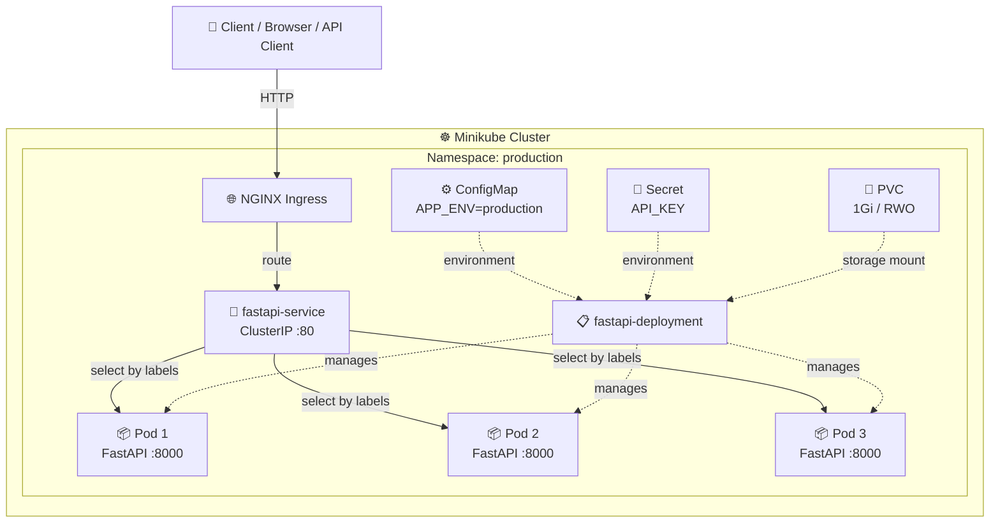
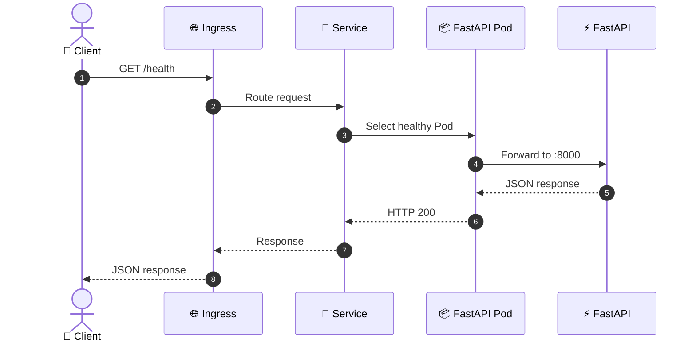

# ☸️ Kubernetes Deployment — FastAPI on Minikube

<p align="center">
  <strong>Containerize → Deploy → Expose → Scale → Roll Forward → Roll Back</strong>
</p>

<p align="center">
  A hands-on Kubernetes project demonstrating how a Dockerized FastAPI REST API is deployed and managed on a local Minikube cluster using declarative Kubernetes manifests.
</p>

<p align="center">
  
  
  
  
  
</p>

---

## 📌 Table of Contents

<details open>
<summary><strong>Click to expand</strong></summary>

- [🎯 Project Objective](#-project-objective)
- [🧠 What This Project Teaches](#-what-this-project-teaches)
- [🏗️ Architecture](#️-architecture)
- [🔄 Request Flow](#-request-flow)
- [📁 Project Structure](#-project-structure)
- [🐍 FastAPI Application](#-fastapi-application)
- [🐳 Docker](#-docker)
- [☸️ Kubernetes Resources](#️-kubernetes-resources)
- [🚀 Deployment](#-deployment)
- [🔎 Verification](#-verification)
- [🧪 API Testing](#-api-testing)
- [📈 Scaling](#-scaling)
- [🔄 Rolling Update](#-rolling-update)
- [↩️ Rollback](#️-rollback)
- [🌐 Ingress](#-ingress)
- [🩺 Troubleshooting](#-troubleshooting)
- [🧹 Cleanup](#-cleanup)
- [🎥 Demo / YouTube Walkthrough](#-demo--youtube-walkthrough)
- [📚 Kubernetes Cheat Sheet](#-kubernetes-cheat-sheet)
- [✅ Assignment Coverage](#-assignment-coverage)
- [👨‍💻 Author](#-author)

</details>

---

## 🎯 Project Objective

The goal is to take a simple **FastAPI REST API**, package it as a Docker image, and deploy it to Kubernetes on a local **Minikube** cluster.

The project demonstrates the core Kubernetes workflow:

```text
FastAPI Code
     ↓
Docker Image
     ↓
Minikube Cluster
     ↓
Deployment → Pods
     ↓
Service → Stable Networking
     ↓
Ingress → HTTP Routing
     ↓
Scale / Update / Rollback
```

### Kubernetes features implemented

| Feature | Resource | What it demonstrates |
|---|---|---|
| Isolation | Namespace | Groups application resources |
| Application management | Deployment | Desired replicas and rollouts |
| Workload | Pod | Runs the FastAPI container |
| Networking | Service | Stable endpoint for Pods |
| Configuration | ConfigMap | Non-sensitive configuration |
| Secrets | Secret | Sensitive configuration |
| Storage | PVC | Persistent storage request |
| HTTP routing | Ingress | Routes HTTP traffic to Service |
| Scaling | Deployment replicas | Runs multiple application Pods |
| Release management | Rolling update | Gradual version replacement |
| Recovery | Rollback | Returns to a previous revision |

---

## 🧠 What This Project Teaches

### The simplest mental model

> **Docker runs the application. Kubernetes manages the application.**

| Component | Think of it as | Responsibility |
|---|---|---|
| Docker | 📦 Package | Packages the FastAPI app and dependencies |
| Minikube | 🖥️ Local Kubernetes cluster | Provides Kubernetes locally |
| Namespace | 🗂️ Folder | Organizes resources |
| Deployment | 👨‍✈️ Manager | Maintains the desired number of Pods |
| Pod | 🏠 Runtime unit | Runs the application container |
| Service | 📞 Stable phone number | Provides stable networking to Pods |
| ConfigMap | ⚙️ Settings file | Stores non-sensitive configuration |
| Secret | 🔐 Locked configuration | Stores sensitive values |
| PVC | 💾 Storage request | Requests persistent storage |
| Ingress | 🚪 HTTP gateway | Routes external HTTP requests |

### One sentence to remember

```text
Ingress finds the Service → Service finds the Pods → Pods run the container.
```

---

## 🏗️ Architecture



> **Storage note:** this project uses a `ReadWriteOnce (RWO)` PVC. That means the storage is not being presented as a general-purpose shared filesystem for all replicas. Treat the PVC as persistent storage attached according to the storage class/access-mode behavior of the local cluster.

### Why each layer exists

1. **Ingress** handles HTTP routing.
2. **Service** gives the Pods a stable network identity.
3. **Deployment** keeps the desired number of Pods running.
4. **Pods** run the FastAPI container.
5. **ConfigMap / Secret** provide configuration to the workload.
6. **PVC** provides persistent storage when the application needs it.

---

## 🔄 Request Flow



---

## 📁 Project Structure

```text
Kubernetes-Deployment/
│
├── app/
│   └── main.py              # FastAPI application
│
├── k8s/
│   ├── namespace.yaml       # Namespace
│   ├── configmap.yaml       # Non-sensitive configuration
│   ├── secret.yaml          # Secret values
│   ├── pvc.yaml             # PersistentVolumeClaim
│   ├── deployment.yaml      # Deployment + Pods
│   ├── service.yaml         # ClusterIP Service
│   └── ingress.yaml         # Ingress routing
│
├── Dockerfile               # Container image definition
├── requirements.txt         # Python dependencies
├── .gitignore
└── README.md
```

> 🔐 **Security:** Never commit real API keys, passwords, tokens, `.env` files, or production secrets.

Recommended `.gitignore`:

```gitignore
venv/
__pycache__/
*.pyc
.DS_Store
.env
```

---

## 🐍 FastAPI Application

The application lives in:

```text
app/main.py
```

### Endpoints

| Method | Endpoint | Purpose |
|---|---|---|
| `GET` | `/` | Returns application/environment information |
| `GET` | `/health` | Health-check endpoint |

Example response:

```json
{
  "msg": "Fastapi application running on Kubernetes",
  "environment": "production"
}
```

Health response:

```json
{
  "status": "healthy"
}
```

---

## 🐳 Docker

The Dockerfile packages the FastAPI application into a portable container image.

### Build the image

```bash
docker build -t docker-fastapi:v5 .
```

### Verify the image

```bash
docker images | grep docker-fastapi
```

### Make the image available to Minikube

```bash
minikube image load docker-fastapi:v5
```

### Why this step matters

Minikube has its own container runtime/environment. Loading the image makes the locally built image available to the Kubernetes workload without requiring the image to be pushed to Docker Hub.

---

# ☸️ Kubernetes Resources

All Kubernetes manifests are inside the `k8s/` directory.

## 1️⃣ Namespace — `namespace.yaml`

Creates:

```text
production
```

This keeps the application's Kubernetes resources logically grouped.

---

## 2️⃣ ConfigMap — `configmap.yaml`

Stores non-sensitive configuration such as:

```text
APP_ENV=production
```

**Use ConfigMap for:** application settings that are not secrets.

---

## 3️⃣ Secret — `secret.yaml`

Stores sensitive configuration such as an API key.

> ⚠️ Kubernetes Secrets are encoded, not automatically equivalent to encrypted password storage. Protect access to the cluster and avoid committing real secret values to Git.

---

## 4️⃣ PersistentVolumeClaim — `pvc.yaml`

Requests persistent storage:

```text
Size:        1Gi
Access Mode: ReadWriteOnce
```

A PVC separates the application's storage request from the underlying storage implementation.

---

## 5️⃣ Deployment — `deployment.yaml`

The Deployment is the main workload controller.

It defines things such as:

- container image
- container port
- replica count
- environment variables
- ConfigMap/Secret references
- volume mounts
- update strategy

Example desired state:

```yaml
replicas: 3
```

Kubernetes continuously works to keep that desired state satisfied.

---

## 6️⃣ Service — `service.yaml`

Creates a stable internal endpoint:

```text
fastapi-service:80
        ↓
    targetPort 8000
```

The Service uses Pod labels to discover the correct workload Pods.

This means Pods can be replaced without forcing clients to know individual Pod IP addresses.

---

## 7️⃣ Ingress — `ingress.yaml`

Provides HTTP routing into the cluster.

Conceptually:

```text
HTTP Request
     ↓
Ingress
     ↓
fastapi-service
     ↓
FastAPI Pods
```

For Minikube, the NGINX Ingress addon may need to be enabled:

```bash
minikube addons enable ingress
```

---

# 🚀 Deployment

## Step 1 — Start Minikube

```bash
minikube start
```

Verify:

```bash
minikube status
```

---

## Step 2 — Enable Ingress

```bash
minikube addons enable ingress
```

> If you are only testing through `kubectl port-forward`, Ingress is not required for that specific test. It is enabled here because Ingress is part of the assignment.

---

## Step 3 — Build the Docker image

```bash
docker build -t docker-fastapi:v5 .
```

---

## Step 4 — Load the image into Minikube

```bash
minikube image load docker-fastapi:v5
```

---

## Step 5 — Apply Kubernetes manifests

```bash
kubectl apply -f k8s/
```

If the manifests reference the namespace before it exists, simply apply the directory again:

```bash
kubectl apply -f k8s/
```

Then verify:

```bash
kubectl get all -n production
```

---

## 🔎 Verification

### Pods

```bash
kubectl get pods -n production
```

Expected state:

```text
NAME                                   READY   STATUS    RESTARTS
fastapi-deployment-xxxxx-xxxxx         1/1     Running   0
fastapi-deployment-xxxxx-xxxxx         1/1     Running   0
fastapi-deployment-xxxxx-xxxxx         1/1     Running   0
```

### Deployment

```bash
kubectl get deployment -n production
```

### Service

```bash
kubectl get service -n production
```

### ConfigMap

```bash
kubectl get configmap -n production
```

### Secret

```bash
kubectl get secret -n production
```

### PVC

```bash
kubectl get pvc -n production
```

Expected:

```text
STATUS: Bound
```

### Ingress

```bash
kubectl get ingress -n production
```

### Complete resource view

```bash
kubectl get all -n production
```

---

# 🧪 API Testing

The most reliable local test is `kubectl port-forward`.

### Terminal 1

```bash
kubectl port-forward -n production service/fastapi-service 8000:80
```

Keep this terminal running.

### Terminal 2

Test the root endpoint:

```bash
curl http://localhost:8000/
```

Test health:

```bash
curl http://localhost:8000/health
```

You can also open:

```text
http://localhost:8000/
http://localhost:8000/health
```

### What port-forward means

```text
localhost:8000
      ↓
kubectl port-forward
      ↓
Service :80
      ↓
Pod :8000
      ↓
FastAPI
```

It is excellent for local testing because you do not need to expose the Service publicly.

---

# 📈 Scaling

Start with 3 replicas:

```bash
kubectl get deployment fastapi-deployment -n production
```

Scale to 5:

```bash
kubectl scale deployment fastapi-deployment --replicas=5 -n production
```

Verify:

```bash
kubectl get pods -n production
```

Verify the Deployment:

```bash
kubectl get deployment fastapi-deployment -n production
```

Expected:

```text
READY   UP-TO-DATE   AVAILABLE
5/5     5             5
```

### What happened?

```text
3 Pods
  ↓ scale
5 Pods
```

The Deployment controller created additional Pods until the desired replica count was reached.

---

# 🔄 Rolling Update

A rolling update replaces the old application version gradually instead of stopping the entire workload at once.

## Step 1 — Change the application

Update `app/main.py` so the response identifies the new version, for example:

```text
Kubernetes v6
```

## Step 2 — Build v6

```bash
docker build -t docker-fastapi:v6 .
```

## Step 3 — Load v6 into Minikube

```bash
minikube image load docker-fastapi:v6
```

## Step 4 — Update the Deployment

```bash
kubectl set image deployment/fastapi-deployment fastapi=docker-fastapi:v6 -n production
```

> `fastapi` must match the **container name** defined in `deployment.yaml`.

## Step 5 — Watch the rollout

```bash
kubectl rollout status deployment/fastapi-deployment -n production
```

Inspect Pods:

```bash
kubectl get pods -n production
```

Inspect rollout history:

```bash
kubectl rollout history deployment/fastapi-deployment -n production
```

### Concept

```text
Old Pods
   ↓
New Pods created
   ↓
Traffic moves to new Pods
   ↓
Old Pods removed
   ↓
New version running
```

---

# ↩️ Rollback

If the new version has a problem, Kubernetes can return to a previous Deployment revision.

### View revisions

```bash
kubectl rollout history deployment/fastapi-deployment -n production
```

### Roll back

```bash
kubectl rollout undo deployment/fastapi-deployment -n production
```

### Wait for completion

```bash
kubectl rollout status deployment/fastapi-deployment -n production
```

### Verify

```bash
kubectl get pods -n production
curl http://localhost:8000/
```

### Mental model

```text
v5 → v6
     ↓
   Problem
     ↓
rollback
     ↓
v5
```

---

# 🌐 Ingress

Check the configured Ingress:

```bash
kubectl get ingress -n production
```

Describe it if troubleshooting:

```bash
kubectl describe ingress fastapi-ingress -n production
```

For a Minikube environment, you can inspect the cluster's Ingress setup with:

```bash
minikube addons list
```

If needed:

```bash
minikube addons enable ingress
```

> The exact external access method depends on the Minikube driver, networking setup, and local environment. `kubectl port-forward` remains the simplest deterministic API test.

---

# 🩺 Troubleshooting

## Pods are not running

```bash
kubectl get pods -n production
kubectl describe pod <pod-name> -n production
kubectl logs <pod-name> -n production
```

## Deployment is not ready

```bash
kubectl describe deployment fastapi-deployment -n production
kubectl rollout status deployment/fastapi-deployment -n production
```

## Check recent cluster events

```bash
kubectl get events -n production --sort-by=.lastTimestamp
```

## Image cannot be pulled

Check the image exists:

```bash
docker images | grep docker-fastapi
```

Load it into Minikube:

```bash
minikube image load docker-fastapi:v5
```

Then inspect the Pod:

```bash
kubectl describe pod <pod-name> -n production
```

## Service is not responding

```bash
kubectl get service -n production
kubectl get endpoints -n production
```

Check the Pod labels and Service selector in the YAML files.

## API works in the Pod but not through Service

Test directly inside the Pod:

```bash
kubectl exec -it <pod-name> -n production -- curl http://localhost:8000/health
```

Then test the Service through port-forward:

```bash
kubectl port-forward -n production service/fastapi-service 8000:80
```

---

# 🧹 Cleanup

## Stop port-forward

In the port-forward terminal:

```text
Ctrl + C
```

## Delete Kubernetes resources

If the cluster is running:

```bash
kubectl delete -f k8s/
```

Or delete the complete namespace:

```bash
kubectl delete namespace production
```

## Stop Minikube

```bash
minikube stop
```

## Delete the Minikube cluster completely

```bash
minikube delete
```

> After `minikube delete`, Kubernetes commands such as `kubectl delete -f k8s/` cannot contact the Kubernetes API server because the cluster no longer exists.

## Remove unused Docker volumes

```bash
docker volume prune
```

## Remove project images if no longer needed

```bash
docker rmi docker-fastapi:v5
```

If v6 also exists:

```bash
docker rmi docker-fastapi:v6
```

---

# 🎥 Demo / YouTube Walkthrough

A strong project demonstration should follow the same order as the architecture.

### 1. Explain the problem

> “I have a FastAPI application. I will containerize it with Docker and deploy it to Kubernetes using Minikube.”

### 2. Show the project structure

Explain:

```text
app/      → application
k8s/      → Kubernetes manifests
Dockerfile → container image
```

### 3. Explain the Kubernetes resources

Show each file:

1. `namespace.yaml`
2. `configmap.yaml`
3. `secret.yaml`
4. `pvc.yaml`
5. `deployment.yaml`
6. `service.yaml`
7. `ingress.yaml`

### 4. Deploy

```bash
minikube start
minikube addons enable ingress
docker build -t docker-fastapi:v5 .
minikube image load docker-fastapi:v5
kubectl apply -f k8s/
kubectl get all -n production
```

### 5. Test the API

```bash
kubectl port-forward -n production service/fastapi-service 8000:80
```

Then:

```bash
curl http://localhost:8000/
curl http://localhost:8000/health
```

### 6. Demonstrate scaling

```bash
kubectl scale deployment fastapi-deployment --replicas=5 -n production
kubectl get pods -n production
```

### 7. Demonstrate rolling update

Build/load v6 and run:

```bash
kubectl set image deployment/fastapi-deployment fastapi=docker-fastapi:v6 -n production
kubectl rollout status deployment/fastapi-deployment -n production
```

### 8. Demonstrate rollback

```bash
kubectl rollout undo deployment/fastapi-deployment -n production
kubectl rollout status deployment/fastapi-deployment -n production
```

This gives the demo a complete story:

```text
Build → Deploy → Verify → Scale → Update → Rollback
```

---

# 📚 Kubernetes Cheat Sheet

| Task | Command |
|---|---|
| Start Minikube | `minikube start` |
| Stop Minikube | `minikube stop` |
| Delete cluster | `minikube delete` |
| Cluster status | `minikube status` |
| Enable Ingress | `minikube addons enable ingress` |
| Apply manifests | `kubectl apply -f k8s/` |
| List Pods | `kubectl get pods -n production` |
| List all resources | `kubectl get all -n production` |
| Describe Pod | `kubectl describe pod <pod> -n production` |
| View logs | `kubectl logs <pod> -n production` |
| Scale Deployment | `kubectl scale deployment fastapi-deployment --replicas=5 -n production` |
| Rollout status | `kubectl rollout status deployment/fastapi-deployment -n production` |
| Rollout history | `kubectl rollout history deployment/fastapi-deployment -n production` |
| Rollback | `kubectl rollout undo deployment/fastapi-deployment -n production` |
| Port-forward | `kubectl port-forward -n production service/fastapi-service 8000:80` |
| Delete manifests | `kubectl delete -f k8s/` |

---

# ✅ Assignment Coverage

| Requirement | Status |
|---|:---:|
| Dockerize application | ✅ |
| Kubernetes Namespace | ✅ |
| Deployment | ✅ |
| Service | ✅ |
| ConfigMap | ✅ |
| Secret | ✅ |
| PersistentVolumeClaim | ✅ |
| Ingress | ✅ |
| Multiple replicas | ✅ |
| Scaling demonstration | ✅ |
| Rolling update | ✅ |
| Rollback | ✅ |
| Local Minikube deployment | ✅ |
| API testing | ✅ |
| Troubleshooting commands | ✅ |

---

# 🧠 Key Takeaways

### 1. Docker vs Kubernetes

```text
Docker      → Packages and runs the application
Kubernetes  → Manages the application at scale
```

### 2. Deployment vs Pod

```text
Deployment → Controller / desired state
Pod        → Actual running workload
```

### 3. Service vs Pod IP

```text
Pod IP      → Can change
Service IP  → Stable endpoint
```

### 4. ConfigMap vs Secret

```text
ConfigMap → Non-sensitive configuration
Secret    → Sensitive configuration
```

### 5. Scaling vs Rolling Update vs Rollback

```text
Scaling       → How many replicas?
Rolling Update → Which version should run?
Rollback      → Return to a previous revision
```

### The complete mental model

```text
                 ┌──────────────────┐
                 │      Client      │
                 └────────┬─────────┘
                          │
                          ▼
                 ┌──────────────────┐
                 │     Ingress      │
                 └────────┬─────────┘
                          │
                          ▼
                 ┌──────────────────┐
                 │     Service      │
                 └────────┬─────────┘
                          │
                 ┌────────┴────────┐
                 ▼                 ▼
           ┌──────────┐      ┌──────────┐
           │   Pod    │ ...  │   Pod    │
           │ FastAPI  │      │ FastAPI  │
           └──────────┘      └──────────┘
                 ▲                 ▲
                 └──── Deployment ─┘
```

> **Kubernetes is fundamentally about desired state:** you describe what you want in YAML, and Kubernetes continuously works to make the cluster match that desired state.

---

## 👨‍💻 Author

**Vijay Rangvani**  
Backend & AI Engineering Learner

Built with ❤️ while learning and implementing:

- 🐍 Python
- ⚡ FastAPI
- 🐳 Docker
- ☸️ Kubernetes
- 🧩 Minikube
- 🌐 REST APIs
- 🏗️ DevOps & Cloud Engineering

> **Learn → Build → Deploy → Test → Improve**

---

⭐ If you found this project useful, consider giving the repository a star!

